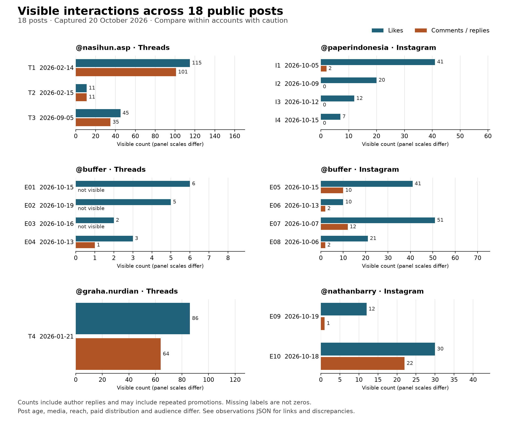

# Cahaves writing defaults: evidence and decisions

Observed 20 October 2026. The recommendation is a **friendly, specific and useful voice**, with a relevant product mention when the brief calls for it. It is an editable starting point for the requested soft-promotion use case, not a statistically identified engagement winner.

The initial sample inspected 18 public posts and four reply examples using fresh anonymous headless Chromium sessions. A [follow-up study of sumopodcloud, monveo.app and shobrunjb](requested-accounts.md) adds 22 posts and their reply context, bringing the research to 40 public posts. The sample includes Indonesian ERP founder Nasihun, a technical-interest account, Paper, Buffer and Kit founder Nathan Barry. Barry's two examples promote a book, so they are adjacent founder-marketing evidence. We inspected captions and exposed comments; we did not fully review every carousel or video. No personal browser, private session or credentials were used.

The chart uses different panel scales. These are snapshots, not engagement rates. Unknown counts stay unknown. Reach, paid distribution, historical audience size and conversions are not available. Post ages and media differ. Replies can include the author, complaints and repeated promotions.

## Useful contrasts, including contradictory evidence

| Same-account observation | Visible likes / replies or comments | What it tells us |
|---|---:|---|
| Nasihun: [specific ERP experience and discussion, Feb 14](https://www.threads.com/@nasihun.asp/post/DUvLzpwE1sh) versus [general encouragement, Feb 15](https://www.threads.com/@nasihun.asp/post/DUxQkNekfQY) | 115 / 101 versus 11 / 11 | Specific experience attracted more observed interaction in this pair. Both use conversational Indonesian, so it does not isolate a pronoun or slang effect. Revenue remains the author's unverified claim. |
| Paper: [direct fee offer, Oct 4 label](https://www.instagram.com/paperindonesia/p/DeGbF2rmEdi/) versus [month-end closing problem, Oct 11 label / 12 UTC](https://www.instagram.com/paperindonesia/p/DeYdRt6ETgH/) | 41 / 2 versus 12 / 0 | Direct promotion can also do well. The older offer and different creative prevent a controlled comparison. |
| Buffer Instagram: [workflow feature Reel, Oct 7](https://www.instagram.com/buffer/reel/DeMrECgjCR6/) versus [customer case carousel, Oct 13](https://www.instagram.com/buffer/p/DecDPtvDYvF/) | 51 / 12 versus 10 / 2 | Both lead with practical context. Format, collaboration and age differ. The Reel's metadata says 44 likes while its rendered UI says 51; both observations are retained. |
| Nathan Barry: [Oct 18 book Reel](https://www.instagram.com/nathanbarry/reel/DepHdr0g8HX/) versus [Oct 19 book Reel](https://www.instagram.com/nathanbarry/reel/DeroyWAguIC/) | 30 / 22 versus 12 / 1 | At least six exposed comments on the first repeat editing-service promotions. Raw comment totals are not a clean measure of useful discussion. |

Buffer's [Threads case study](https://www.threads.com/@buffer/post/DecDLbmIPAc) has one visible reply, which is its own follow-up link. Its [contest](https://www.threads.com/@buffer/post/DehGJAXEUrD) has three reposts, not three replies. These distinctions are preserved instead of treating every displayed number as audience engagement.

## The accounts requested for Cahaves Cloud and Hisabin

The [additional study and graph](requested-accounts.md) distinguish a cloud operator's practical voice, a product brand's audience questions, and a founder's personal product and support stories. The [editable Cahaves profile](cahaves-default-profile.json) applies those patterns only to the relevant product brief and leaves facts and approved examples blank. Its live installation is recorded in the [deployment report](../../deployment/cahaves-writing-personalization.md).

## Defaults implemented in the assistant

| Dimension | Initial behavior | User control |
|---|---|---|
| Language | Follow the current message or draft; support Indonesian and English | Explicit language selection or a per-draft instruction |
| Tone | Friendly, readable, concrete; vary structure to fit the message | Professional/casual selection, voice notes and approved examples |
| Indonesian | Preserve the author's pronouns; allow useful product/technical English | No automatic gue/lu, regional slang or fixed code-mixing percentage |
| English | Everyday words and natural contractions when appropriate | No inferred dialect, nationality, founder persona or compulsory humor |
| Instagram | Add context to supplied media; clear opening and useful detail | No invented carousel/video content; optional CTA and conservative hashtag guidance |
| Threads | One self-contained point with enough context; relevant product detail | No required question, controversy, sales pitch or rigid hook formula |
| Replies | Answer the actual question or acknowledge the specific comment | Product facts and context required; never invent a staff signature or roadmap promise |
| Facts | Use the current brief and saved brand facts | Voice examples supply phrasing, not transferable claims or personal history |

The model receives these defaults and the saved workspace profile on every native writing request. It does not scrape social media on each request, train a model, import outside posts into approved examples, or automatically learn from likes. Add your own approved writing to the profile to refine its voice. Comment replies can be drafted from pasted context; this feature does not add an inbox or automatically send replies to comments.

## Platform guidance and uncertainty

Meta's [Threads educational insights](https://about.fb.com/news/2024/10/find-your-community-with-new-threads-educational-insights/), published October 2024 and updated June 2025, support original Threads content and useful conversation. They are platform-wide observations, not evidence that any particular Indonesian or English wording wins. Instagram's [Best Practices announcement](https://about.fb.com/news/2024/10/best-practices-education-hub-creators-instagram/), October 2024, explicitly includes account-personalized guidance.

Instagram's official [December 2025 hashtag announcement](https://www.instagram.com/creators/p/DSalTolEbvf/) says up to five hashtags; an accessible API reference still describes 30. The assistant uses conservative writing guidance, while the connector's actual validation remains authoritative. Threads text attachments exist separately from ordinary text posts. This update retains Postiz's existing 500-character Threads and 2,200-character Instagram limits and does not add attachment support.

I'm unsure which voice would improve Cahaves' engagement. There is no controlled comparison, reliable exposure denominator or Cahaves account history in this study. Test the defaults on Cahaves posts, compare similar topics and formats over the same observation window, and inspect useful replies and business actions rather than raw totals alone. Do not infer a universal best posting hour or caption length from this sample.

Confidence: 95% for the recorded observations and provenance; 90% for the default as an editable editorial fit. Performance transfer is uncertain and is not used as a rollout claim.

## Audit files

- [Indonesian findings and primary sources](indonesian-findings.md), [observations JSON](indonesian-observations.json)
- [English findings and primary sources](english-findings.md), [observations JSON](english-observations.json), [posts CSV](english-posts.csv), [replies CSV](english-replies.csv)
- [Chart SVG](observed-interactions.svg), [chart PNG](observed-interactions.png), [reproduction script](render_chart.py) (Python with matplotlib and NumPy)

Only paraphrases and public metric observations are stored. These research examples are not approved Cahaves voice samples. The Intura aggregate study was excluded because of internal count/interpretation inconsistencies; its links were used only to discover canonical posts that were then checked directly.
