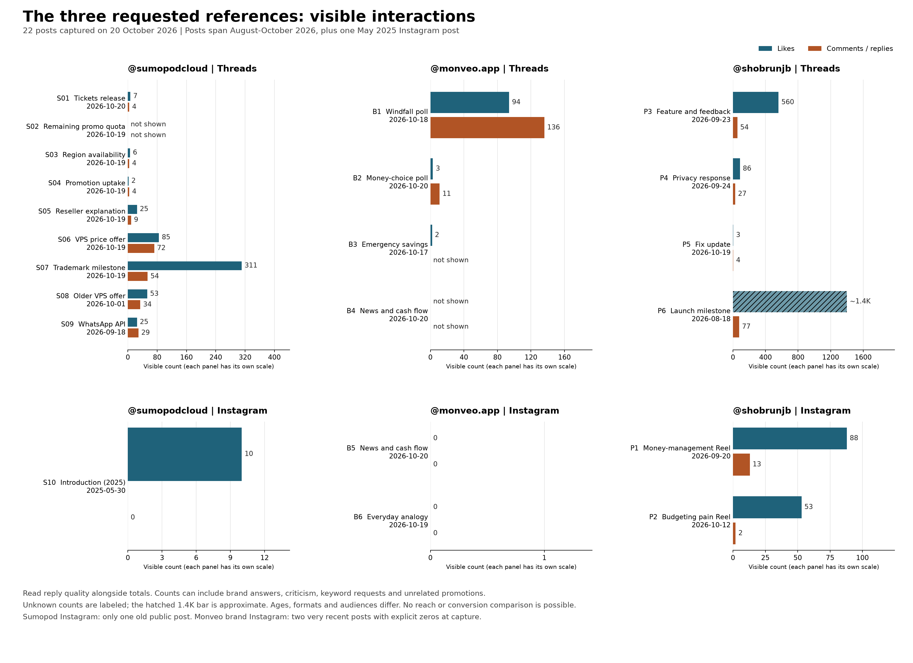

# Applying Sumopodcloud, Monveo and Shobrun to Cahaves

Captured on 20 October 2026 using separate anonymous headless browsers. This extension adds 22 posts to the earlier 18-post study: ten from Sumopodcloud, six from Monveo's brand account and six Monveo-related posts from Shobrun. It also inspects loaded replies, including direct answers, criticism and requests for help. These are selected examples, not a representative sample of Indonesian social media.

The recommended default is a helpful person explaining something specific. Cahaves Cloud should sound like an operator who understands the builder's task. A problem-oriented Hisabin post should explain a real money or admin difficulty and a relevant action. A founder can speak from personal experience when the brief supplies that experience. The brand should not invent one.

Each chart panel uses its own scale. Ages, audiences, media and distribution differ. The 1.4K label is rounded, missing counts are unknown, and current follower counts are not historical reach. These totals cannot rank the three accounts' marketing effectiveness.

| Reference | What the public posts show | Useful Cahaves adaptation |
| --- | --- | --- |
| [sumopodcloud](https://www.threads.com/@sumopodcloud) | Operational updates, direct offers and short support answers. The [ticket announcement](https://www.threads.com/@sumopodcloud/post/DetBC_vlI_V) explains the change and its location. The [VPS offer](https://www.threads.com/@sumopodcloud/post/DeqyEKTFHMU) has 85 likes and 72 displayed replies, including many brand answers. | Give Cloud readers a concrete task, change or limitation. Explain pricing conditions and the next step when verified. Direct promotion is appropriate for a genuine offer; urgency is not a default voice. |
| [monveo.app](https://www.threads.com/@monveo.app) | Accessible money questions and analogies. Its [windfall poll](https://www.threads.com/@monveo.app/post/Den442ciYBc) has 94 likes and 136 displayed replies, mostly choices about money priorities in the loaded subset. | Use understandable situations and relevant questions for Hisabin. A response to a hypothetical is not evidence of product demand, so avoid optimizing solely for comment volume. |
| [shobrunjb](https://www.threads.com/@shobrunjb) | Personal product stories, demos, changes prompted by feedback and support conversations. His [feature announcement](https://www.threads.com/@shobrunjb/post/Ddn2xIyGUyO) has 560 likes and 54 displayed replies. His [Instagram money-management Reel](https://www.instagram.com/shobrunjb/reel/DdfjN7pTiDo/) has 88 likes and 13 comments, including requested keywords and a brand self-comment. | Use a supplied real experience or product decision, then explain the relevant benefit or limitation. A first-person voice belongs to an identified author. A keyword-to-DM CTA requires a working delivery process. |

Shobrun describes building Monveo in his [17 October 2026 article](https://shobrunjb.com/blog/designer-to-ai-builder). The selected Instagram reels display the personal and brand accounts as coauthors. This supports the association; it does not independently verify user counts, revenue, rankings or product claims.

## Read the replies before choosing a pattern

A higher count can reflect a need for clarification. Sumopod's [additional-fees answer](https://www.threads.com/@sumopodcloud/post/DddceeulA7Q) clarifies a charge outside the advertised price. Cahaves should include known material conditions in the offer itself. Its [hourly-billing answer](https://www.threads.com/@sumopodcloud/post/Deq3t06lCoS) is a concise statement of a limitation. The writing pattern is useful; the actual policy belongs to Sumopod.

Shobrun's [privacy response](https://www.threads.com/@shobrunjb/post/DdqEQYbGSYQ) has 86 likes and 27 displayed replies, including substantive criticism. That is not 27 endorsements. His [recent fix update](https://www.threads.com/@shobrunjb/post/DerKEfgE_wR) has four loaded replies that form a conversation about another developer's service. His [response to a reported balance bug](https://www.threads.com/@shobrunjb/post/DcK7mTeGSeB) acknowledges the issue and offers a next step; the captured exchange does not prove resolution.

Only one old Instagram post was exposed for Sumopodcloud. Monveo's two sampled brand Instagram posts were very recent and showed explicit zeros at capture. These observations cannot establish which Instagram format, caption length or posting hour will work best.

## Preferences saved in Postiz

[cahaves-default-profile.json](cahaves-default-profile.json) was updated and read back on the Cahaves workspace at revision 3 on 20 October 2026. At Refi's request, it now gives distinct Indonesian and English guidance: relaxed everyday Indonesian with familiar technical terms, and plain conversational English with natural contractions. It follows the requested language, or the brief's language when unspecified, and keeps languages separate unless bilingual copy is requested. These are editorial preferences, not measured performance claims.

The profile uses a friendly tone and applies Cloud or Hisabin notes only when that product is named in the brief. A problem-first structure applies to a problem-oriented brief, leaving announcements and replies free to use an appropriate structure. Brand facts and approved examples remain empty because the research does not establish Cahaves product claims or authorize copying competitor posts.

In Indonesian, preserve the author's established pronouns and use familiar technical terms when helpful. Do not automatically add gua, lu, kak or exaggerated slang. In English, use ordinary wording rather than literal translations of Indonesian address terms or particles. These are editorial choices supported by the writing examples, not measured language-performance rules.

For a reply, provide the root post, target comment, relevant preceding exchange and current product facts. Answer the question first, acknowledge a reported problem, and offer a verified next step. Do not invent support channels, privacy assurances, discounts, partnerships, savings, stock or roadmap dates. The current feature drafts replies from pasted context; it does not retrieve or send Instagram/Threads comment replies.

The profile is an editable workspace setting, not a new product-specific branch in the generic AI service. Every native generation uses the saved profile. This is prompt personalization, not fine-tuning or automatic learning from other accounts' metrics. Deployment records state whether the profile was actually saved on the live workspace.

## How to learn from Cahaves' own posts

Treat this as a starting hypothesis. Compare posts of similar age, topic and format within the same Cahaves account. Record the brief, language, product, content intent, media, publication time and any paid distribution. Use the same observation window, such as seven days, for each post. The seven-day window is a proposed experiment design, not a proven ideal.

Record visible likes and replies, then classify useful questions, objections, complaints, brand answers, keyword requests and unrelated promotions separately. Use first-party analytics for reach and verified downstream actions when available. Keep unknowns unknown. The useful outcome may be a qualified product question, a resolved support exchange or a verified signup, depending on the post's purpose.

I'm unsure which voice will increase Cahaves acquisition. This study has no controlled Cahaves comparison or conversion data, so a meaningful percentage for that outcome cannot be justified. It would take Cahaves posts with comparable exposure and reliable downstream measurements to assess it.

Confidence: 95% for the inspected source observations and associations; 92% for the proposed voice as an editable fit. Neither number is a growth prediction.

## Source records

- [Sumopod findings](sumopodcloud-findings.md), [observations and eight reply examples](sumopodcloud-observations.json), [post CSV](sumopodcloud-posts.csv)
- [Monveo and Shobrun findings](monveo-shobrun-findings.md), [observations and reply evidence](monveo-shobrun-observations.json)
- [Chart data](requested-accounts-chart-data.json), [render script](render_requested_accounts.py), [SVG](requested-accounts-interactions.svg), [PNG](requested-accounts-interactions.png)

The reports preserve source disagreements, quoted-post attribution, capture times and missing values. They use paraphrases; outside captions are not installed as Cahaves examples.
